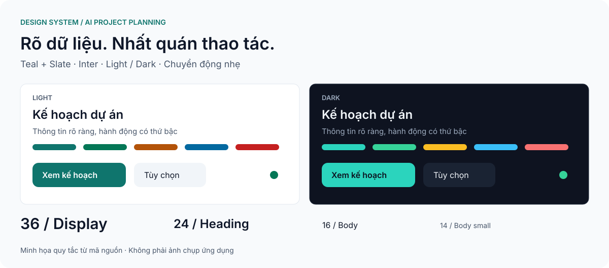
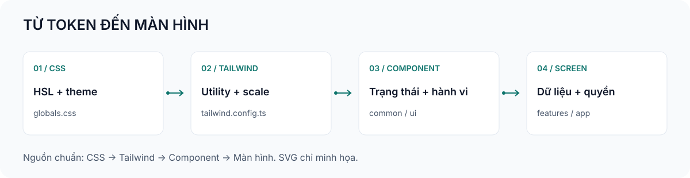
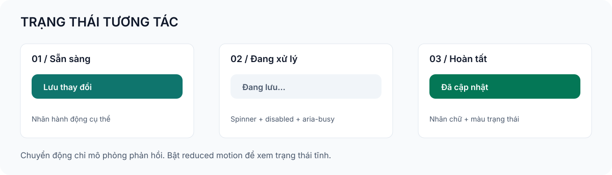

# Design system cho AI Project Planning và Portfolio Management

<p align="center">
  
</p>

**Cập nhật:** 22/10/2026 · **Trạng thái:** Tài liệu hóa mã nguồn hiện tại · **Phạm vi:** Giao diện web quản lý dự án và danh mục.

Tài liệu này giúp thiết kế và phát triển các màn hình nhất quán với giao diện đang có. Quy tắc được đối chiếu từ CSS, cấu hình Tailwind và component trong repository. Các tiêu chí nghiệm thu bên dưới là yêu cầu kiểm tra khi thay đổi giao diện, không phải chứng nhận toàn bộ ứng dụng đã đạt chuẩn.

Ảnh SVG bên trên và trong tài liệu có chuyển động CSS nhẹ như cách README nhúng SVG. Nếu trình xem Markdown không phát animation, ảnh vẫn hiển thị trạng thái tĩnh có đầy đủ nội dung. Mở liên kết ảnh để xem riêng; bật giảm chuyển động trên hệ điều hành để dừng hiệu ứng.

## Mục lục

1. [Tóm tắt](#1-tóm-tắt)
2. [Mục tiêu và giới hạn](#2-mục-tiêu-và-giới-hạn)
3. [Bối cảnh và nguyên tắc](#3-bối-cảnh-và-nguyên-tắc)
4. [Kiến trúc design system](#4-kiến-trúc-design-system)
5. [Vòng đời tương tác](#5-vòng-đời-tương-tác)
6. [Token và hợp đồng component](#6-token-và-hợp-đồng-component)
7. [Nhất quán và đồng bộ trạng thái](#7-nhất-quán-và-đồng-bộ-trạng-thái)
8. [Khả năng tiếp cận và bảo vệ dữ liệu](#8-khả-năng-tiếp-cận-và-bảo-vệ-dữ-liệu)
9. [Kiểm tra và vận hành](#9-kiểm-tra-và-vận-hành)
10. [Lựa chọn và đánh đổi](#10-lựa-chọn-và-đánh-đổi)
11. [Điểm cần hoàn thiện](#11-điểm-cần-hoàn-thiện)
12. [Quy trình cập nhật](#12-quy-trình-cập-nhật)

## 1 Tóm tắt

Giao diện dùng **slate cho nền và chữ, teal cho hành động chính**, cùng các màu ngữ nghĩa cho thành công, cảnh báo, thông tin và thao tác nguy hiểm. Theme sáng và tối dùng chung tên token; component không cần tự chọn bảng màu theo từng chế độ.

Nền tảng gồm Inter hỗ trợ tiếng Việt, thang chữ riêng trong Tailwind, lưới khoảng cách 4px, góc bo chủ đạo 12px và chuyển động ngắn. Ưu tiên đọc dữ liệu, nhận biết hành động và sử dụng bằng bàn phím trên cả máy tính lẫn điện thoại.

## 2 Mục tiêu và giới hạn

| Mục tiêu | Giới hạn của lần tài liệu hóa |
|---|---|
| Dùng cùng màu, chữ và trạng thái cho các trang | Không thay đổi component hoặc giao diện chạy thật |
| Dẫn trực tiếp tới nguồn định nghĩa token | Không thay đổi API, quyền hay dữ liệu nghiệp vụ |
| Có minh họa động, vẫn đọc được khi tắt chuyển động | Hình là mô phỏng quy tắc, không phải ảnh chụp ứng dụng |
| Có checklist kiểm tra responsive và accessibility | Không khẳng định đạt WCAG hay hiệu năng khi chưa đo |

## 3 Bối cảnh và nguyên tắc

Các màn hình có mật độ dữ liệu khác nhau: dashboard, WBS, danh sách task, Gantt, biểu mẫu và luồng AI. Design system là điểm thống nhất giữa chúng. Tài liệu kiến trúc nghiệp vụ tiếp tục nằm tại [thiết kế kiến trúc hệ thống](specs/system-architecture/design.md).

- Mỗi khu vực nên có một hành động chính nổi bật. Dùng outline hoặc ghost cho hành động phụ.
- Màu thể hiện ý nghĩa; trạng thái luôn có nhãn chữ. Không chỉ dùng màu hoặc chấm tròn để truyền đạt kết quả.
- Ưu tiên cấu trúc trang phẳng, phân cấp bằng chữ, khoảng cách và viền. Không lồng nhiều lớp card cho cùng một thông tin.
- Giữ đúng khái niệm Phase, Sprint, mốc thời gian và ngày dự án; trình bày không được làm thay đổi nghiệp vụ.
- Hiệu ứng hỗ trợ phản hồi thao tác. Không thêm thư viện animation chỉ để minh họa tài liệu.

## 4 Kiến trúc design system



| Lớp hiện có | Nguồn | Vai trò |
|---|---|---|
| Giá trị màu và theme | [globals.css](../frontend/src/app/globals.css) | Khai báo bộ ba HSL tại `:root` và `:root.dark` |
| Ánh xạ và thang thiết kế | [tailwind.config.ts](../frontend/tailwind.config.ts) | Chuyển token thành utility; định nghĩa chữ, góc bo, bóng và animation |
| Component chung | [common](../frontend/src/components/common), [ui](../frontend/src/components/ui) | Button, Modal, Card, Badge, Select, TabNav |
| Quản lý theme | [ThemeProvider](../frontend/src/components/theme/ThemeProvider.tsx) | Light, dark, system; đồng bộ lựa chọn qua localStorage |
| Màn hình nghiệp vụ | `frontend/src/features`, `frontend/src/app` | Ghép component với dữ liệu và quyền |

Hiện tại màu được định nghĩa trực tiếp bằng token ngữ nghĩa. Chưa có bộ primitive màu và bộ component token độc lập theo mô hình ba tầng. Không coi các tầng đó là đã triển khai; khi cần mở rộng, bổ sung alias có chủ đích để giữ tương thích với utility đang dùng.

## 5 Vòng đời tương tác



1. **Sẵn sàng:** Nhãn hành động cụ thể, ví dụ “Lưu thay đổi”; biểu mẫu có nhãn trường và hướng dẫn cần thiết.
2. **Focus hoặc hover:** Focus ring phải thấy rõ. Hover chỉ bổ trợ vì điện thoại không có con trỏ.
3. **Đang xử lý:** Button dùng `isLoading`, hiển thị Spinner, vô hiệu hóa nút và đặt `aria-busy`. Dữ liệu chờ tải có thể dùng Skeleton.
4. **Thành công:** Hiển thị kết quả bằng nhãn rõ ràng và màu success. Không dùng hiệu ứng làm thay đổi kích thước cả bố cục.
5. **Lỗi:** Giữ nội dung nhập, giải thích trường cần sửa hoặc hành động thử lại. Đây là yêu cầu cho màn hình sử dụng component, không phải hành vi tự có của mọi component.
6. **Đóng hộp thoại:** Modal hỗ trợ Escape, giữ focus trong hộp thoại, trả focus về phần tử trước đó và quản lý khóa cuộn trang.

Các trạng thái loading của Button chỉ hạn chế thao tác lặp ở giao diện; việc chống ghi lặp phải do API hoặc nghiệp vụ xử lý.

## 6 Token và hợp đồng component

### 6.1 Màu ngữ nghĩa

Giá trị bên dưới là **bộ ba HSL**, giữ nguyên như mã nguồn. Dùng `hsl(var(--primary))` trong CSS, hoặc utility như `bg-primary/10` để giữ khả năng thay đổi độ trong suốt.

| Token | Sáng | Tối | Cách dùng |
|---|---|---|---|
| `background` | `210 40% 98%` | `224 40% 6%` | Nền trang |
| `foreground` | `222 47% 11%` | `210 40% 96%` | Chữ chính |
| `card` | `0 0% 100%` | `222 40% 9%` | Mặt nội dung |
| `primary` | `175 77% 26%` | `172 66% 50%` | Hành động chính |
| `primary-foreground` | `0 0% 100%` | `222 47% 8%` | Chữ trên primary |
| `secondary` | `210 40% 96%` | `217 33% 15%` | Hành động phụ |
| `muted` | `210 40% 96%` | `217 33% 15%` | Vùng thông tin phụ |
| `muted-foreground` | `215 19% 35%` | `215 20% 68%` | Chữ phụ |
| `accent` | `166 76% 96%` | `175 40% 14%` | Nền hover hoặc nhấn nhẹ |
| `destructive` | `0 72% 45%` | `0 91% 71%` | Xóa, thao tác nguy hiểm |
| `success` | `163 94% 24%` | `158 64% 52%` | Thành công |
| `warning` | `26 90% 37%` | `43 96% 56%` | Cảnh báo |
| `info` | `201 96% 32%` | `198 93% 60%` | Thông tin |
| `border` | `214 32% 91%` | `217 30% 18%` | Viền mặt nội dung |
| `input` | `213 27% 84%` | `215 25% 27%` | Viền trường nhập |
| `ring` | `175 77% 30%` | `172 66% 50%` | Focus ring |

Các cặp `*-foreground`, `*-soft`, `popover` và `shadow-color` còn lại lấy trực tiếp từ [nguồn CSS](../frontend/src/app/globals.css). Không thay thế chúng bằng màu Tailwind cố định trong component dùng chung.

### 6.2 Typography

[Root layout](../frontend/src/app/layout.tsx) tải Inter qua `next/font/google` và cung cấp biến `--font-sans`. Font mono dùng hệ thống cho mã hoặc dữ liệu kỹ thuật.

| Utility chữ | Cỡ chữ | Line height | Vai trò |
|---|---|---|---|
| `text-display` | 36px | 40px | Tiêu đề lớn, dùng hạn chế |
| `text-h1` | 30px | 36px | Tiêu đề trang |
| `text-h2` | 24px | 32px | Tiêu đề khu vực |
| `text-h3` | 20px | 28px | Nhóm nội dung |
| `text-h4` | 16px | 24px | Tiêu đề card |
| `text-lead` | 18px | 28px | Đoạn dẫn |
| `text-body` | 16px | 24px | Nội dung chính |
| `text-body-sm` | 14px | 20px | Dữ liệu gọn, mô tả |
| `text-caption` | 12px | 16px | Chú thích |
| `text-overline` | 11px | 16px | Nhãn phụ ngắn |

Quy đổi px giả định cỡ chữ gốc 16px; mã nguồn dùng rem. Display và các cấp h1–h4 khai báo font weight 600. Dùng `max-w-prose-ui` (68ch) cho nội dung dài, không dùng overline cho đoạn văn quan trọng. Ô dữ liệu bảng có `tabular-nums` để số thẳng cột.

### 6.3 Khoảng cách và hình khối

| Thuộc tính | Hiện trạng |
|---|---|
| Nhịp khoảng cách | Theo lưới 4px; thường dùng gap 8, 12, 16, 24px |
| Card | `rounded-xl`, padding `p-4 sm:p-6` tương ứng 16/24px |
| Radius token | `--radius: 0.75rem`; `lg` 12px, `md` 10px, `sm` 8px tại root 16px |
| Modal | `rounded-2xl`, tối đa `max-w-2xl`; body cuộn riêng |
| Bóng | `shadow-xs`, `shadow-soft`, `shadow-soft-md`, `shadow-soft-lg` |
| Focus toàn cục | Outline 2px, offset 3px; component có thể dùng ring riêng |

`rounded-xl` của Card dùng giá trị mặc định Tailwind; không nhầm với token `rounded-lg` được ánh xạ từ `--radius`, dù hiện tại cùng ra 12px.

### 6.4 Component

| Component | Hợp đồng hiện có | Lưu ý khi sử dụng |
|---|---|---|
| [Button](../frontend/src/components/common/Button.tsx) | Variant `default`, `secondary`, `outline`, `ghost`, `destructive`, `link`; size `sm`, `md`, `lg`, `icon` | `fullWidth` mặc định **true**; đặt false cho nút trong toolbar |
| Button loading | `isLoading` khóa nút, thêm Spinner và `aria-busy` | Giữ nhãn hành động có nghĩa; không thay tất cả bằng icon |
| ButtonLink | Liên kết Next.js có hình thức nút; `fullWidth` mặc định false | Dùng cho điều hướng, Button cho hành động |
| [Card](../frontend/src/components/ui/Card.tsx) | `interactive`, `flush`, `as`; Header, Title, Description, Content, Footer | `interactive` thêm hover nhưng không tự biến div thành nút có semantics bàn phím |
| [Badge](../frontend/src/components/ui/Badge.tsx) | Tone `neutral`, `primary`, `success`, `warning`, `danger`, `info`; size sm/md; `dot` | Tone nguy hiểm tên là `danger`, khác variant `destructive` của Button |
| [Select](../frontend/src/components/ui/Select.tsx) | Select native, `hasError`, `wrapperClassName`; cao 44px | Caller phải cung cấp label; `hasError` đặt `aria-invalid`, không tự tạo thông báo lỗi |
| [Modal](../frontend/src/components/common/Modal.tsx) | `open`, `onClose`, `title`, `description`, `footer` | Có dialog semantics, focus trap, phục hồi focus và cuộn body |
| [TabNav](../frontend/src/components/ui/TabNav.tsx) | Item có href, label, icon, badge, active | Là điều hướng trang với `aria-current`, không phải tabpanel ARIA |

Button sm có min-height 36px; md/icon 44px và lg 48px. Ưu tiên md hoặc lớn hơn cho hành động chính trên điện thoại; không khẳng định mọi biến thể đều đạt 44px.

Các thành phần bổ trợ được dùng lại khi ghép trang:

| Mục đích | Component và nguồn | Hành vi cần lưu ý |
|---|---|---|
| Đầu trang và khu vực | [PageHeader, SectionHeader](../frontend/src/components/ui/PageHeader.tsx) | PageHeader mặc định `animate=false`, `compact=true`; chỉ bật hiệu ứng chữ khi cần |
| Chọn chế độ hiển thị | [SegmentedControl](../frontend/src/components/ui/SegmentedControl.tsx) | `value`, `onChange`, `options`, `label`; nhóm nút với `aria-pressed`, min-height 36px |
| Đang tải | [LoadingState](../frontend/src/components/common/PageState.tsx) | Variant `inline`, `cards`, `table`, `page`; truyền label theo ngôn ngữ ứng dụng |
| Khung chờ từng vùng | [Skeleton](../frontend/src/components/ui/Skeleton.tsx) | Có SkeletonCard, SkeletonTable, SkeletonText, SkeletonStatGrid, SkeletonRegion và mẫu trang |
| Rỗng và lỗi | [EmptyState, ErrorState](../frontend/src/components/common/PageState.tsx) | EmptyState hỗ trợ action/secondaryAction; ErrorState có onRetry/retryLabel |
| Xuất hiện nội dung | [RevealText, Reveal](../frontend/src/components/motion/RevealText.tsx) | Hiệu ứng CSS; giữ nguyên câu tiếng Việt và tên truy cập |
| Số liệu KPI | [CountUp](../frontend/src/components/motion/CountUp.tsx) | Duration mặc định 600ms; reduced motion hiển thị ngay kết quả |
| Breadcrumb động | [useBreadcrumbLabel](../frontend/src/components/layout/Breadcrumbs.tsx) | Đăng ký nhãn theo href, dùng tên thực thay cho ID khi đã tải được |

Mẫu bố cục trang: PageHeader → bộ lọc → trạng thái tải/lỗi/rỗng hoặc nội dung. Dùng `space-y-8` giữa khu vực, `gap-4/6` giữa card và `gap-2/3/4` trong component. Với phần bổ sung mới, ưu tiên thang chữ đã khai báo thay vì cỡ chữ tùy ý; giữ comment mã bằng tiếng Việt.

Với bảng, dùng Card `flush`, wrapper `overflow-x-auto`, tiêu đề cột nền `bg-muted/50`, ô `px-4 py-3`; thêm tên truy cập và kiểm tra cuộn bằng bàn phím. Bố cục có panel phụ có thể dùng `grid gap-6 lg:grid-cols-[minmax(0,1fr)_320px]`, xếp dọc khi hẹp. Đây là hướng dẫn ghép trang, cần kiểm chứng với dữ liệu thật và viewport đích.

Ví dụ tái sử dụng, không tạo API component mới:

```tsx
import { Button } from '@/components/common/Button'
import { Badge } from '@/components/ui/Badge'
import { Card, CardTitle } from '@/components/ui/Card'

<Card>
  <CardTitle>Kế hoạch dự án</CardTitle>
  <div className="mt-4 flex flex-wrap items-center justify-between gap-3">
    <Badge tone="success" dot>Đã cập nhật</Badge>
    <Button type="button" fullWidth={false}>Xem kế hoạch</Button>
  </div>
</Card>
```

### 6.5 Responsive và chuyển động

Tailwind không ghi đè breakpoint nên dùng mốc mặc định: sm 640px, md 768px, lg 1024px, xl 1280px, 2xl 1536px. Đây là ngưỡng CSS, không phải kích thước thiết bị bắt buộc.

- Màn hình hẹp: xếp nội dung theo một cột, cho nhóm nút wrap; bảng/Gantt cần vùng cuộn riêng thay vì làm cả trang tràn ngang.
- TabNav cuộn ngang; tab đang mở được đưa vào tầm nhìn. Modal giới hạn chiều cao theo `100dvh`, phần nội dung có `overflow-y-auto`.
- `.page-enter` dùng fade-up 300ms; scale-in và fade-in 200ms; word-rise 450ms; shimmer 1,8s lặp.
- Easing chủ đạo `cubic-bezier(0.22, 1, 0.36, 1)`; Card interactive nâng 2px và Button active scale 0,98.
- CSS toàn cục giảm thời gian animation/transition khi `prefers-reduced-motion: reduce`. Cần kiểm tra riêng chuyển động do JavaScript gọi, chẳng hạn `scrollIntoView({ behavior: 'smooth' })` trong TabNav.

## 7 Nhất quán và đồng bộ trạng thái

ThemeProvider hỗ trợ `light`, `dark`, `system`; cập nhật class dark trên phần tử gốc, lưu lựa chọn cục bộ, nghe storage event giữa các tab và thay đổi theme hệ điều hành khi chọn system.

Thứ tự nguồn chuẩn cho màu là **CSS token → ánh xạ Tailwind → component → màn hình**. SVG trong tài liệu là minh họa, không phải nguồn để copy màu thay thế token. Khi cập nhật token, cập nhật cả bảng trong tài liệu và ảnh tương ứng để tránh lệch thông tin.

Quy tắc UI không thay thế hợp đồng dữ liệu: ngày, phần trăm, số tiền, trạng thái task và quyền truy cập phải lấy từ logic nghiệp vụ. Skeleton chỉ là placeholder, không được hiển thị như dữ liệu thật.

## 8 Khả năng tiếp cận và bảo vệ dữ liệu

- Mục tiêu nghiệm thu: chữ thường đạt tương phản ít nhất 4,5:1; chữ lớn 3:1; kiểm tra từng cặp nền/chữ thực tế ở cả hai theme, gồm opacity và ảnh nền.
- Điều hướng được bằng Tab/Shift+Tab; focus luôn thấy rõ; Modal giữ và trả focus đúng. Kiểm tra cả trường hợp nhiều lớp modal.
- Input/Select có label liên kết, lỗi bằng chữ và mô tả liên kết tới trường. Không dùng placeholder làm label duy nhất.
- Icon trang trí ẩn khỏi screen reader; nút chỉ icon cần tên truy cập. Badge có nhãn trạng thái rõ ràng.
- Zoom 200% vẫn đọc và thao tác được; kiểm tra tiếng Việt có dấu, tên dài và trạng thái rỗng.
- Ẩn nút theo quyền chỉ là trình bày; backend phải xác thực quyền thao tác. Ảnh tài liệu không chứa token đăng nhập, dữ liệu cá nhân hoặc dữ liệu dự án thật.

## 9 Kiểm tra và vận hành

| Hạng mục | Tiêu chí cần kiểm tra | Bằng chứng |
|---|---|---|
| Theme | Sáng, tối, system; refresh và đồng bộ tab | Ảnh và thao tác trình duyệt |
| Responsive | 320px, 390px, 768px, 1440px; thêm viewport thấp | Không tràn toàn trang, nút và footer tiếp cận được |
| Trạng thái | Default, focus, disabled, loading, empty, error, success | Mỗi luồng chính có trạng thái kiểm tra được |
| Bàn phím | Tab, Shift+Tab, Escape; phục hồi focus | Thử thực tế, không chỉ đọc ARIA |
| Chuyển động | Bật và tắt reduced motion | Kiểm tra CSS và hiệu ứng do JavaScript tạo |
| Nội dung | Tiếng Việt, nhãn dài, ngày/số đúng nghiệp vụ | Đối chiếu nguồn dữ liệu và bản dịch |
| Tài liệu | Ảnh, link và token đồng bộ | Kiểm tra file/link; SVG có trạng thái tĩnh |

Khi thay đổi mã giao diện, chạy các lệnh trong thư mục `frontend`:

```powershell
npm run lint
npm run type-check
npm test
npm run build
```

Đây là bộ lệnh kiểm tra cho thay đổi giao diện; lần cập nhật tài liệu này không đồng nghĩa đã chạy lại hoặc nghiệm thu ứng dụng. Các bằng chứng UI cũ tại [audit](ui-audit-2026-10-20/README.md) và [redesign](ui-redesign-2026-10-20/README.md) có ngày riêng, cần kiểm tra lại trước khi dùng làm kết luận hiện tại.

## 10 Lựa chọn và đánh đổi

| Lựa chọn | Lợi ích | Đánh đổi |
|---|---|---|
| HSL ngữ nghĩa và Tailwind | Đổi theme tập trung, hỗ trợ alpha | Cần đồng bộ tên token giữa CSS và config |
| Component đang có | Giữ hành vi và giảm mã lặp | Caller vẫn chịu trách nhiệm semantics và nội dung |
| Select native | Giữ picker di động và bàn phím có sẵn | Ít tự do tạo hình menu tùy biến |
| SVG động nhúng Markdown | Nhẹ, rõ ở nhiều độ phân giải, không thêm dependency | Một số trình xem tắt animation; cần ảnh tĩnh vẫn đọc được |
| CSS transition ngắn | Phản hồi dễ nhận biết, ít chi phí | Không đủ cho mô phỏng phức tạp; tài liệu không cần loại đó |

## 11 Điểm cần hoàn thiện

1. Chưa có bằng chứng trong tài liệu này về tương phản của mọi tổ hợp component, đặc biệt nền ảnh và trạng thái hover/disabled.
2. Cần rà soát các utility màu hard-code ở màn hình nghiệp vụ trước khi khẳng định toàn bộ ứng dụng dùng token thống nhất.
3. Cần xác minh reduced motion cho các lệnh cuộn mượt do JavaScript điều khiển.
4. Người sở hữu, người duyệt và quy trình phê duyệt design system chưa được chỉ định; không tự gán tên hoặc trạng thái Approved.

## 12 Quy trình cập nhật

Tái sử dụng token và component trước khi thêm biến thể. Khi cần một mẫu mới, ghi rõ nơi sử dụng, các trạng thái, cách dùng bàn phím, responsive và hành vi reduced motion; chỉ bổ sung sau khi nhu cầu được xác nhận trong công việc liên quan.

| Bước | Đầu ra | Điều kiện hoàn tất |
|---|---|---|
| 1 | Xác định token/component cần sửa | Chỉ ra nguồn và màn hình chịu tác động |
| 2 | Cập nhật mã và ví dụ sử dụng | Giữ API tương thích hoặc ghi rõ thay đổi |
| 3 | Kiểm tra giao diện | Có bằng chứng desktop/mobile, theme và bàn phím |
| 4 | Cập nhật tài liệu và hình | Giá trị khớp nguồn, liên kết đúng, reduced motion hoạt động |

**Lịch sử:** 22/10/2026 — Tạo tài liệu design system riêng từ mã nguồn hiện tại, theo cấu trúc nội dung mẫu System Design; thêm ba SVG minh họa động. Tài liệu kiến trúc hệ thống hiện có được giữ nguyên.

22/10/2026 — Hợp nhất hướng dẫn UI nội bộ vào tài liệu này và xóa bản trùng cũ trong thư mục tài liệu frontend. Bổ sung các component hỗ trợ, mẫu bố cục trang và sửa mô tả mặc định của PageHeader theo mã hiện tại.
